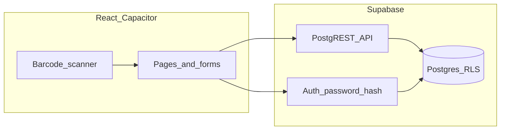

# CashFlow: поетапна архитектура (React + Supabase + Capacitor)

> Запазен roadmap за дипломния проект. Връщай се тук при всяка фаза.
> Източник: план от Cursor (`cashflow_roadmap`).

## Отговор: UI първо или функционалност първо?

**Нито чисто UI-first, нито „сървър без екрани завинаги“.**

За този проект най-лесно и дипломно-коректно е:

1. **Сървър първо** (schema + RLS + auth) — както иска заданието.
2. **Всеки feature като тънък вертикален slice**: работеща логика + **използваем, прост mobile UI** (форми, списъци, навигация) — без пикселен polish.
3. **QR + Capacitor рано** (след ръчните разходи) — най-рисковата част се валидира на реален телефон.
4. **Визуален polish накрая** — когато потоците и данните са стабилни; иначе преработваш красиви екрани всеки път.

Чисто UI-first губи време при промяна на модела. Чисто backend-only забавя проверка на камерата и UX за семейство/лимити. Хибридът по-горе е балансът.

---

## Какво имаше в началото

Работещ **auth skeleton** върху Vite + React 19 + Supabase + Tailwind + React Router:

- Signup / Signin / Dashboard + `PrivateRoute` + `AuthContext`
- Няма DB schema за разходи/семейство, няма миграции, няма Capacitor

Запазваме стека; добавяме **Capacitor** за Android (основен target за тестове с камера).

---

## Целева архитектура (проста)



- **REST API + релационна БД**: Supabase PostgREST върху Postgres.
- **Пароли**: хеширане през Supabase Auth.
- **Синхронизация**: всички данни в облака; RLS за лични vs семейни разходи.
- **OCR / push / CSV**: извън MVP.

### Схема на данните (минимална)

- `profiles` — `id` (FK auth.users), `display_name`, `personal_monthly_limit`
- `categories` — seed (Храна, Транспорт, …)
- `families` — `name`, `invite_code`, `created_by`, `monthly_limit`
- `family_members` — `family_id`, `user_id`, `role` (`owner` | `member`)
- `expenses` — `user_id`, `family_id` (nullable), `amount`, `spent_at`, `category_id`, `note`, `scope` (`personal` | `family`), `fiscal_memory_no`, `receipt_no`

RLS:
- Личен разход: само собственикът
- Семеен разход: всички членове; автор редактира/трие своите; owner маха членове

Прогноза: `P = avg(R1..Rn)` за последните `n=3` завършени месеца; отделно personal vs family.

### Целева структура на кода

```
src/
  lib/supabase.js
  context/AuthContext.jsx
  pages/
  components/
  features/
    expenses/
    family/
    analytics/
    receipts/
  layouts/AppShell.jsx
supabase/migrations/
docs/resources/          # планове, QR бележки, бележки
```

---

## Фази

### Фаза 0 — Основа
Статус: **имплементирана в кода** (изпълни SQL migration в Supabase и тествай).

- Почистване auth; профил (име) при регистрация
- `supabase/migrations` + `profiles` + trigger
- Mobile shell с bottom nav
- Capacitor + Android

**Готово когато:** вход/изход/профил работят на телефон.
Виж: [phase-0-setup.md](./phase-0-setup.md)

### Фаза 1 — Сървър за разходи
Статус: **имплементирана в кода** (изпълни SQL migration в Supabase).

- `categories`, `expenses` + RLS + ръчен CRUD и филтри
- Виж: [phase-1-setup.md](./phase-1-setup.md)

### Фаза 2 — QR бележки
Статус: **имплементирана в кода** (тествай paste в браузър + реален телефон).

- Реални бележки, parser, дедуп, Capacitor scanner + fallback
- Виж: [phase-2-setup.md](./phase-2-setup.md), [qr-receipt-format.md](./qr-receipt-format.md)

### Фаза 3 — Семейство
- Invite code, RLS, общ лимит

### Фаза 4 — Анализи, лимит, прогноза
- Графики, предупреждения, прогноза n=3

### Фаза 5 — Polish
- UI pass, валидации, README аргументация на стека

---

## Karpathy правила

- Една фаза = един фокус; без speculative OCR/abstraction layers
- Явни verify критерии преди код
- Surgical changes върху съществуващия auth
- QR формат — валидирай с реални бележки, не гадай

## Извън MVP засега

- OCR, push, CSV, лимити по категория
- Отделен Express сървър
- React Native rewrite
